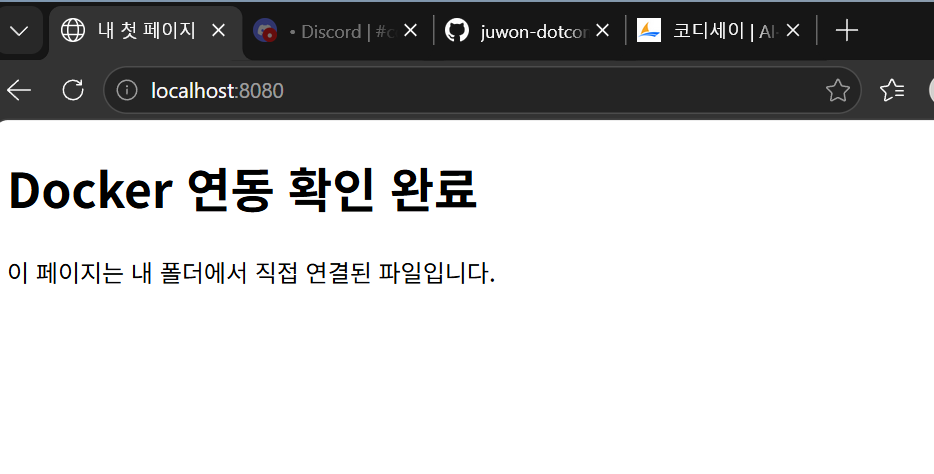

# -1
코디세이 1-1 연습

# 기본 명령어
- pwd: 현 위치
- ls: 목록 (단, ls -l / ls -a 처럼 옵션 형태는 리눅스 방식)
- mkdir: 폴더 생성
- cd: 폴더로 이동
- New-Item 또는 ni: 빈 파일 생성
- "A" > B: A의 내용을 B 파일에 넣기
- cat: 파일 내용 보기
- cp: 파일 복사
- mv: 이름 바꾸기 또는 옮기기(원본 삭제)
- rm: 파일 삭제 
- ; (세미콜론): 여러 명령러를 한 줄에 이어서 실행
- -Force(리눅스 -a): all (숨김 파일, 종료된 것까지 전부)
- Ctrl + C: 지금 실행 중인 명령 멈춰
- whoami: 현재 사용자 이름
- CMD: 컨테이너가 실행될 때 기본으로 할 일
- #: 주석(설명용, 실행 안 됨)
- code: VScode로 파일 열기(편집기에 등장, 내용 작성 편함)  
- ls -l	파일 권한을 자세히 보기 (-l = long)
- ls -ld	디렉토리 자체의 권한 보기 (-d)
- chmod 644	권한을 644로 변경 (chmod = change mode)
- ls -l과 ls -ld 차이: -d 없이 폴더를 보면 폴더 안 내용이 나와요. -d를 붙여야 폴더 자체 권한이 보여요.

**리눅스(≒ubuntu) 전용** 쉘(bash)
  - ls -l: 상세 목록(권한·소유자·크기 표시)  →  PowerShell: Get-ChildItem 또는 dir
  - ls -a: 숨김 파일까지 모두 표시  →  PowerShell: -Force 옵션
  - touch 파일명: 빈 파일 생성  →  PowerShell: New-Item 또는 ni
  - chmod 755 파일명: 권한을 숫자로 변경 (7=rwx, 5=r-x)
   →  PowerShell: icacls / Set-ItemProperty
  - chmod 644 파일명: 소유자만 수정 가능하게 변경
  - chown 사용자 파일명: 파일 소유자 변경  →  PowerShell: icacls
  - man 명령어: 명령어 설명서 보기  →  PowerShell: Get-Help
  - FROM: 어떤 이미지를 바탕으로 시작할지 (여기선 ubuntu)

**권한 읽는 법**
- -rw-r--r--   1 root  root   6  Nov 3 09:26  test.txt   
└┘└--┘ └┘└┘ └┘    
파일종류 권한 소유자 그룹 크기(6바이트="hello"+줄바꿈) 
- 파일종류: - (일반파일) / d (폴더) / l (링크)
- 권한 rw-r--r-- 은 3칸씩: [소유자][그룹][그 외]
  - rw- : 읽기·쓰기 가능, 실행 불가
  - r-- : 읽기만 가능
- 숫자 변환: r=4, w=2, x=1 (더한 값)
  - 7 = rwx (4+2+1)
  - 6 = rw- (4+2)
  - 5 = r-x (4+1)
  - 4 = r-- (4)
  
**Vim 편집기**(git commit을 -m 없이 실행)
- 입력 모드 -> ESC -> 명령 모드 -> i -> 입력 모드
- :: 명령 입력 시작
- w: write(저장)
- q: quit(나가기)
- :q!: 저장 없이 강제로 나가기

**편집기 명령어**
- "```(백틱)"을 문단 위ㆍ아래에 사용: 회색 상자 
- #글자: 글자 커짐 
- ** 글자 **: 굵게 강조
- Ctrl + Shift + V	미리보기 새 탭으로 열기
  Ctrl + K 떼고 V	미리보기 옆에 나란히 열기
- Ctrl + S: 저장
- Ctrl + F: 찾기
- Ctrl + ~ (물결): 터미널 열기/닫기
- Ctrl + /: 주석 처리
- Ctrl + Shift + P: 명령 팔레트 (모든 기능 검색)

**Docker 명령어**
- docker run -it ubuntu bash: 리눅스 컨테이너에 진입
- docker ps: 실행 중인 컨테이너 
- docker run -d: 백그라운드로 컨테이너 실행
- docker ps -a: 종료된 것까지 전부
- docker logs <이름>: 컨테이너 기록 보기(문제 생기면 여기서 원인 찾음)
- docker stats --no-stream: 자원 사용량 1회 확인
- docker images: 이미지 목록
- up : 설정대로 빌드 + 실행
- -d : 백그라운드 실행

# 개발 워크스테이션 구축

## 프로젝트 개요
개발 환경(PowerShell / Docker / Git)을 설치하고
GitHub 저장소를 연결하여 워크스테이션을 구축하는 미션입니다.

## 실행 환경
- **OS**: Windows 11
- **쉘(Shell)**: PowerShell
- **Git 버전**: 2.56.0
- **Docker 버전**: 29.9.2
- **Node 버전**: 26.13.0

# Docker 운영 로그

## 1. 컨테이너 실행
```
PS C:\...\-1> docker run -d --name test-nginx -p 8080:80 nginx
Unable to find image 'nginx:latest' locally
latest: Pulling from library/nginx
...
Status: Downloaded newer image for nginx:latest
51627b07f2da...
```

## 2. 실행 확인
```
PS C:\...\-1> docker ps
CONTAINER ID   IMAGE   ...   STATUS         PORTS                      NAMES
51627b07f2da   nginx   ...   Up 12 seconds  0.0.0.0:8080->80/tcp      test-nginx
```

## 3. 로그 확인
```
PS C:\...\-1> docker logs test-nginx
...
2026/11/03 08:24:20 [notice] 1#1: start worker process 31
```

## 4. 자원 사용량
```
PS C:\...\-1> docker stats --no-stream
CONTAINER ID   NAME         CPU %   MEM USAGE / LIMIT    ...   PIDS
51627b07f2da   test-nginx   0.00%   22.23MiB / 15.25GiB  ...   25
```

# Docker 이미지 빌드 실습 (Dockerfile → 커스텀 이미지)

## 파일 구성
- `Dockerfile` : nginx 기반, index.html을 웹 루트에 복사
- `index.html` : 접속 확인용 테스트 페이지

## Dockerfile 핵심 명령어
- FROM: 바탕이 되는 이미지 지정 (여기선 nginx)
- COPY: 로컬 파일을 이미지 안으로 복사 (index.html → 웹 루트)
- (CMD/EXPOSE 등은 nginx 이미지에 기본 설정됨)

## 실행 순서

### 1. 이미지 빌드
```
PS C:\...\-1\docker-practice> docker build -t my-web .
```
- `-t my-web` : 이미지에 `my-web` 이라는 이름(태그) 붙이기
- `.` : 현재 폴더의 Dockerfile 사용

### 2. 컨테이너 실행
```
PS C:\...\-1\docker-practice> docker run -d -p 8080:80 --name web my-web
```
- `-d` : 백그라운드 실행
- `-p 8080:80` : 내 PC 8080 포트 → 컨테이너 80 포트 연결
- `--name web` : 컨테이너 이름 지정

### 3. 실행 확인
```
PS C:\...\-1\docker-practice> docker ps
CONTAINER ID   IMAGE    COMMAND                   STATUS         PORTS                                     NAMES
b3baf8a94400   my-web   "/docker-entrypoint.…"   Up 3 seconds   0.0.0.0:8080->80/tcp, [::]:8080->80/tcp   web
```

### 4. 브라우저 접속 확인
```
http://localhost:8080
```
→ 접속 성공 (화면 캡처 첨부)


## 트러블슈팅 기록
- **증상**: `docker run` 실행 시 `requires at least 1 argument` 에러
- **원인**: 실행할 이미지 이름을 빠뜨리고 `docker run` 만 입력함
- **해결**: 이미지 이름까지 포함해 `docker run -d -p 8080:80 --name web my-web` 로 재실행
- **참고**: 같은 이름의 컨테이너가 남아 있으면 `docker rm -f web` 로 정리 후 재실행